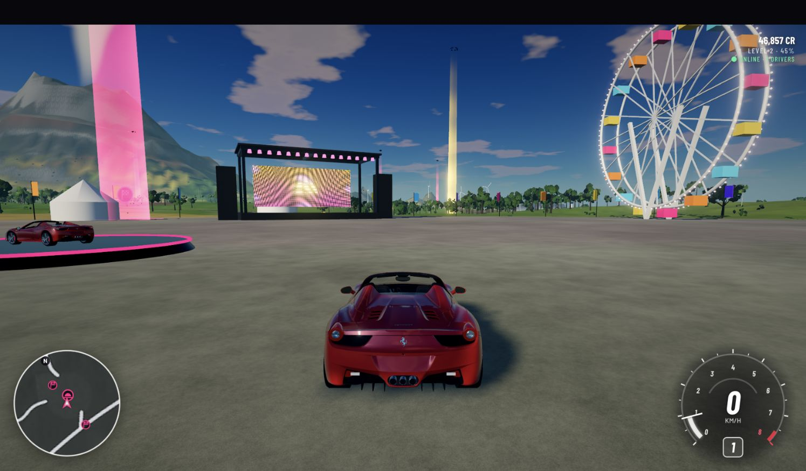

# Horizon Remade

**Explore an island, tune a car, and race with friends — in your browser.**

Horizon Remade is an open-source driving sandbox built with JavaScript and Three.js.
Drive from a festival hub into a hillside city, snowy mountain passes, forests,
dunes and a racing circuit. Play solo against AI or share the world online.

**Status: community alpha.** The game is playable and open to contributions;
performance, handling and multiplayer are still evolving. It targets laptop and
desktop browsers with WebGL2, a keyboard/mouse or a gamepad.



[How to play](docs/PLAYING.md) · [Development](docs/DEVELOPMENT.md) ·
[Host your own game](docs/HOSTING.md) · [Contribute](CONTRIBUTING.md) ·
[Code license](LICENSE) · [Asset credits](THIRD_PARTY_NOTICES.md)

## Run it locally

Clone this repository or download and extract its ZIP, then open a terminal in
the project folder. Use **Node.js 22.12+ in the 22.x series** and npm. If you use
nvm, run `nvm use` to select the version in `.nvmrc`.

```bash
npm ci
npm run dev
```

Open **http://localhost:5173**, or the address Vite prints if that port is occupied.
The first load builds the island and loads the bundled car models and textures.
No account, API key or separate asset download is needed to play locally.

The dev server includes multiplayer. A second browser tab joins the same server;
another computer on your local network can use Vite's printed **Network** address.
For a public website, follow the [hosting guide](docs/HOSTING.md).

## Your first five minutes

1. **Start:** press **Enter** or click the start button, then choose a driver name.
2. **Drive:** **W / S** accelerate and brake/reverse; **A / D** steer. Automatic
   transmission and driving assists are on by default.
3. **Explore:** press **M**, pick a location or event, and choose **SET ROUTE** or
   **FAST TRAVEL**. Fast travelling to a race starts it.
4. **Race:** drive to a glowing race marker and press **Enter**. Choose **RACE SOLO**
   (or **START RACE** while offline) to race AI; follow the checkpoints in order.
5. **Try another car:** press **Esc → MY CARS**. Use **SETTINGS** to adjust graphics,
   assists, weather and sound. Press **T** if stuck, or hold **R** to rewind outside
   online races.

For friends, choose **INVITE & RACE** at a race marker. Others in your world press
**J** to join during the 20-second lobby. Online races continue while menus are open.

### Main controls

| Action | Keyboard / mouse | Gamepad (Xbox-style) |
| --- | --- | --- |
| Accelerate / brake & reverse | W / S or Up / Down arrows | RT / LT |
| Steer | A / D or Left / Right arrows | Left stick |
| Handbrake | Space | A |
| Rewind (hold; outside online races) | R | X |
| Reset to road | T | Right-stick click |
| Change camera / look back | C / B | Y / Left-stick click |
| Look around | Left mouse button + drag | — |
| Shift up / down (manual) | E / Q | RB / LB |
| Start event / confirm | Enter | A |
| World map / festival menu | M / Esc | View / Menu |
| Join online race / chat | J / Y | — |
| Radio / horn / lights | N / H / L | — / D-pad up / D-pad down |

See the [full player guide](docs/PLAYING.md) for progression, multiplayer, saving,
controller details and troubleshooting. Controls are also available in the
festival menu.

## What's in the game?

- **A connected world:** roughly 6 × 6 km, with a volcano, coast, San Francisco-inspired
  city, countryside, snow, canyon roads, dunes and a Formula 1 circuit.
- **Seven playable cars:** Ferrari 458 Italia, Shelby GT500, Porsche 911 GT3, 1967
  Mustang Fastback, McLaren MCL60, Ferrari SF23 and Red Bull RB19. Imported models
  have individual creator credits and licenses.
- **Driving and events:** suspension and tyre physics, driving assists, manual or
  automatic shifting, races, drifts, jumps, skill chains, PR stunts and bonus boards.
- **A changing environment:** day/night, four seasons, rain, storms, fog and snow;
  road wetness and snow affect grip. Online drivers share the same climate.
- **Multiplayer:** shared free roam, chat, race invitations and shared AI opponents.
- **Progression:** credits, XP, Wheelspins, a garage and local records.
- **Procedural systems:** terrain, roads, buildings, vegetation, synthesized engine
  sounds and radio music, alongside attributed models and photographic textures.

Read the [world and feature details](docs/FEATURES.md) for more about the island,
cars, physics, rendering and audio.

## Make it your own

| Idea | Where to start |
| --- | --- |
| Add a mountain race or drift challenge | `src/game/events.js`, `src/game/stunts.js` |
| Tune a car's handling | `src/vehicle/carspecs.js`, `tools/physbench.mjs` |
| Build a new district or scenic route | `src/world/regions.js`, `src/world/districts.js` |
| Experiment with engine sounds | `src/core/engine-profiles.js`, `tools/enginebench.mjs` |
| Build a better AI driver | `src/game/ai.js` |
| Host a world for friends | [Hosting guide](docs/HOSTING.md) |

Customization currently means editing JavaScript; a visual track editor and a
general mod API are opportunities for future contributors. See the
[development guide](docs/DEVELOPMENT.md) for the code map, preview tools and asset
pipeline, and [CONTRIBUTING.md](CONTRIBUTING.md) for how to send changes.

```bash
npm test          # game-system and multiplayer tests
npm run build    # production website in dist/
npm start        # built website + multiplayer at http://localhost:8080
```

The GitHub Actions workflow runs tests and a build on pushes and pull requests.

## Current limitations

- **Desktop controls:** touch driving is not implemented. Browser/GPU performance
  varies; start with Low or Medium graphics if needed.
- **Local saves:** progress lives in this browser's storage, with no account or
  cloud sync. Different browsers or site addresses have separate saves.
- **Casual multiplayer:** the configured limit is 80 players per world; this is
  not a published load-test result. Clients report race progress, and there is no
  authoritative anti-cheat or persistent global leaderboard.
- **Shared settings:** any connected player can change the world's weather, season
  and time of day. Host-only controls and moderation tools are not implemented.
- **Game tuning:** vehicle behaviour and performance figures describe this game,
  not a validated simulation of the real vehicles.

## License and credits

The project's original source code and documentation are available under the
[MIT License](LICENSE). You can use, modify and redistribute that material under
its terms. Third-party models, textures, fonts and libraries keep their own
licenses; **the MIT license does not relicense those assets**.

See [THIRD_PARTY_NOTICES.md](THIRD_PARTY_NOTICES.md) for the complete asset index,
dependency notices and redistribution guidance. The website includes a
[licenses page](public/licenses/index.html), linked from the in-game model credits.

This is an unofficial fan project inspired by Forza Horizon. It is not affiliated
with Microsoft, Xbox Game Studios, Playground Games, vehicle manufacturers or
racing teams. No assets extracted from the Forza games are included. Vehicle
names, liveries, sponsor marks and other trademarks remain with their respective
owners; the code and asset licenses do not grant those trademark rights.
